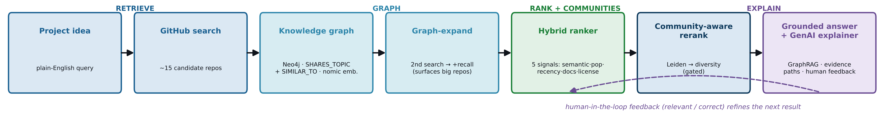

# RepoReason — Architecture

> See [../README.md](../README.md) for setup, prerequisites, and how to reproduce the poster numbers.

---

## End-to-end pipeline

A plain-English project idea flows through six stages, all orchestrated by
[`graphsearch/graph_rank.py`](../graphsearch/graph_rank.py) → `graph_search()`.

```
Plain-English query
  │
  ▼  c3/github_client.py · search_repositories()
GitHub Search API  ──────────────────────────────► ~15 candidate repos
  │
  ▼  graphsearch/graph_builder.py · build_graph()
Neo4j knowledge graph (per-query, wiped & rebuilt each run)
  · :Repo nodes  (full_name, stars, pushed_at, topics, language, embedding)
  · SHARES_TOPIC edges  (any pair sharing ≥ 1 GitHub topic)
  · SIMILAR_TO  edges   (cosine ≥ 0.60, top-5 neighbours; nomic-embed-text)
  │
  ▼  graphsearch/graph_expand.py · expand_via_graph()
Graph-expansion recall
  · Finds the top-5 most-connected ("anchor") repos by degree
  · Extracts their 3 most-common topics → new GitHub search query
  · Returns up to 10 NEW repos not already in the graph
  │
  ▼  graphsearch/graph_builder.py · build_graph()  [second call on full pool]
Rebuild graph on initial + expanded repos (merged, deduplicated)
  │
  ▼  c3/rankers.py · rank_detailed()
Hybrid ranker — 5 weighted signals, each min-max normalised to [0, 1]:
  1. Semantic    (0.45) — cosine(query_embed, repo_embed)  via nomic-embed-text
  2. Popularity  (0.25) — log(stars + 1)
  3. Recency     (0.15) — pushed_at Unix timestamp
  4. Documentation (0.10) — 1 pt description present + 1 pt topics present
  5. License     (0.05) — SPDX license id present and not "NOASSERTION"
  │
  ▼  graphsearch/communities.py
Community detection + relevance-gated diversity rerank
  · Builds an in-memory networkx.Graph (same SHARES_TOPIC + SIMILAR_TO edges)
  · detect_communities(): Leiden via leidenalg + igraph;
                           falls back to networkx Louvain (seed=42)
  · community_aware_rerank(): round-robin over communities in the top-10 head
    — raises top-5 diversity +35% (1.7 → 2.3) at no relevance cost (ΔnDCG +0.002)
  │
  ▼  graphsearch/graph_app.py  (Streamlit UI)
GraphRAG explanation
  · "Why this fits" button → ollama.chat(model="qwen2.5-coder:7b", …)
  · Prompt is grounded in the repo's own fields (name, description, topics,
    language) — model is instructed to invent nothing
  · Human-in-the-loop feedback (relevant / not relevant / wrong-community)
    appended to graphsearch/feedback_log.jsonl
```

---

## Pipeline diagram



---

## Component table

### `graphsearch/`

| Module | Responsibility |
|---|---|
| [`graph_app.py`](../graphsearch/graph_app.py) | Streamlit entry point: runs the full pipeline on query submit, renders ranked/grouped results, calls `qwen2.5-coder:7b` for per-repo explanations, records human-in-the-loop feedback. |
| [`graph_rank.py`](../graphsearch/graph_rank.py) | Orchestrates the six pipeline stages: build → expand → merge → rebuild → hybrid score → community rerank; returns the final result list. |
| [`graph_builder.py`](../graphsearch/graph_builder.py) | Clears Neo4j, embeds every repo with `nomic-embed-text`, creates `:Repo` nodes, and adds `SHARES_TOPIC` / `SIMILAR_TO` edges. |
| [`graph_expand.py`](../graphsearch/graph_expand.py) | Queries Neo4j for the most-connected repos, extracts dominant topics, issues a second GitHub search, and returns new repos not already in the graph. |
| [`communities.py`](../graphsearch/communities.py) | Builds a networkx graph of the full pool, runs Leiden community detection (Louvain fallback), and applies `community_aware_rerank()` for diversity. |

### `c3/`

| Module | Responsibility |
|---|---|
| [`github_client.py`](../c3/github_client.py) | Wraps the GitHub Search API (`/search/repositories`), normalises the response into clean repo dicts (full_name, stars, pushed_at, topics, license, …). |
| [`embeddings.py`](../c3/embeddings.py) | Thin wrapper around `ollama.embed(model="nomic-embed-text", …)`; exposes `embed_text()` and `cosine_similarity()`. |
| [`rankers.py`](../c3/rankers.py) | Four rankers — `rank_native`, `rank_bm25`, `rank_dense`, `rank_hybrid` / `rank_detailed`; the hybrid is the production ranker (5 weighted signals). |
| [`metrics.py`](../c3/metrics.py) | Ranking metrics: `precision_at_k`, `recall_at_k`, `mrr`, `ndcg_at_k` (graded relevance 0/1/2). |
| [`gcn.py`](../c3/gcn.py) | GCN embedding-enrichment experiment (rejected — net-negative due to over-smoothing; not used in the final system). |
| [`run_all.py`](../c3/run_all.py) | Runs all four rankers over the benchmark → `c3/data/all_results.json`. |
| [`run_community_eval.py`](../c3/run_community_eval.py) | 3-way ablation: Traditional RAG / GraphRAG / Community-aware → `c3/data/community_eval.json`. |
| [`run_ablation.py`](../c3/run_ablation.py) | Sweeps hybrid signal weights to find the best configuration. |
| [`run_baselines.py`](../c3/run_baselines.py) | Runs BM25 and native baselines for comparison. |
| [`run_gnn_eval.py`](../c3/run_gnn_eval.py) | Evaluates the rejected GCN enrichment path. |
| [`build_pool.py`](../c3/build_pool.py) | Utility to build the offline candidate pool saved in `c3/data/repos.json`. |

---

## Runtime dependencies

| Service | Role | Models / config |
|---|---|---|
| **Neo4j** | Stores the live per-query knowledge graph (`:Repo` nodes + `SHARES_TOPIC` / `SIMILAR_TO` edges). Wiped and rebuilt on every search. | `NEO4J_URI`, `NEO4J_USERNAME`, `NEO4J_PASSWORD` in `.env` |
| **Ollama** | Local LLM runtime — no external API calls, fully reproducible. | `nomic-embed-text` — all graph and ranking embeddings. `qwen2.5-coder:7b` — "Why this fits" explanations. |

> [!NOTE]
> Both services must be running before launching the app. See [../README.md](../README.md) for `ollama pull` commands and Neo4j setup.

---

## Key results

Measured over 6 project-idea queries × 90 hand-labeled candidate repos (see [`../README.md`](../README.md) for full CIs):

- **Hybrid ranker**: nDCG@10 **0.78**, P@5 **0.93**, MRR **1.00** — best-or-tied on every metric.
- **Community-aware reranking**: top-5 diversity **+35%** (1.7 → 2.3 distinct communities) at no relevance cost (ΔnDCG +0.002).
- **Leiden vs Louvain**: identical community split on this pool (ARI = 1.0); Leiden is preferred when `leidenalg` is installed.

